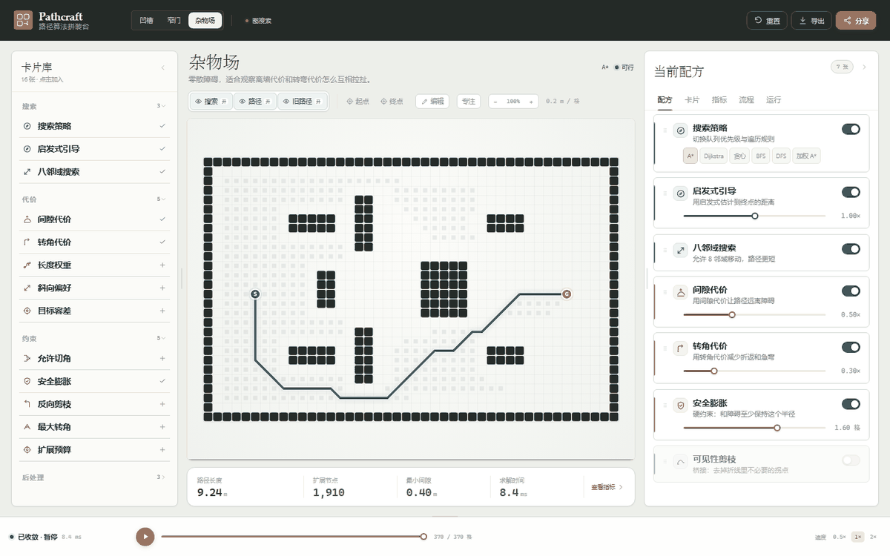

# Pathcraft

**A composable path-planning workbench.**  
用卡片拼装路径规划算法，实时查看搜索过程、最终路径、代价和编译链。

[Live Demo](https://Kind0419.github.io/Pathcraft/) · [GitHub](https://github.com/Kind0419/Pathcraft) · [MIT License](LICENSE)

[](https://Kind0419.github.io/Pathcraft/)

> **在线交互说明**：GitHub 的 README 是静态 Markdown，不能内嵌 iframe / JavaScript 直接运行这个应用。  
> 点击上面的 GIF，或打开 <https://Kind0419.github.io/Pathcraft/> 进入可交互版本。

---

## 这是什么

Pathcraft 是一个运行在浏览器里的 2D 栅格路径规划实验台。

- 左侧选择算法、代价、硬约束和后处理卡片
- 中间实时显示搜索波前、最终路径和上一版路径
- 右侧调整配方、参数、指标，并查看可拖动的算法编译链
- 任一改动都会重新规划；路径会平滑形变，旧路径保留为灰色虚线

适合用来观察不同搜索策略、代价项和约束如何改变路径，不是生产级机器人规划器。

---

## 功能

- 三个 2D 场景：凹槽、窄门、杂物场
- 2D 地图编辑：画墙 / 擦除 / 笔刷 1·3·5 / 清空 / 恢复预设
- 起终点点击与拖动；靠近障碍时吸附到最近安全格
- 搜索回放：播放、暂停、时间轴、0.5x / 1x / 2x
- 搜索 / 路径 / 旧路径图层开关
- 画布 80%–105% 缩放；滚轮或 `− / +`
- 「专注」一键收起两侧面板，地图最大化
- 左 / 右 / 下三个面板可拖拽缩放，缩到阈值自动收起
- 卡片拖动排序、拖出取消、拖动期间禁止选中文字
- 左侧卡片库四组折叠
- 指标页：环形代价图 + 分段条 + 图例
- 流程页：可拖动的编译链，重排后同步回配方
- 无解时在底部指标条显示原因，并直接打开对应参数
- 分享 URL、导出 JSON / CSV
- 单文件离线版本

---

## 算法范围

当前覆盖传统**图搜索主干**，通过「搜索策略」卡一键切换：

| 策略 | 优先级 |
|---|---|
| A* | `g + h` |
| 加权 A* | `g + 1.5h` |
| Dijkstra | `g` |
| 贪心最佳优先 | `h` |
| BFS | FIFO 入队顺序 |
| DFS | LIFO 出栈顺序 |

尚未实现：RRT / RRT* / PRM、D* Lite、JPS、IDA*、双向搜索、Beam、ACO、遗传算法。

这些需要独立的 planner 适配层，不是在当前 A* 引擎里加一个开关就能可靠实现的。项目不会用不可用的占位卡冒充“全部传统算法”。

---

## 在线试用

<https://Kind0419.github.io/Pathcraft/>

如果页面 404：

1. 打开仓库 **Settings → Pages**
2. **Build and deployment → Source** 选择 **GitHub Actions**
3. 打开 **Actions**，等 `Deploy Pathcraft to GitHub Pages` 变绿

---

## 本地运行

需要 Node.js >= 22.12 和 pnpm。

```bash
git clone https://github.com/Kind0419/Pathcraft.git
cd Pathcraft
pnpm install
pnpm dev
```

打开 `http://127.0.0.1:5173/`。

### 检查与构建

```bash
pnpm typecheck
pnpm build
```

### 单文件离线版

```bash
pnpm build
pnpm bundle
```

生成 `release/Pathcraft.html`，双击即可离线打开。

---

## 项目结构

```text
src/
  App.tsx                 布局、状态、URL、拖拽、流程、导出
  styles.css              全部样式
  components/
    CanvasView.tsx        Canvas2D 绘制、命中、起终点、缩放、画笔
    Card.tsx              配方卡片、滑块、开关、choice chips
    Icon.tsx              线性图标
  lib/
    types.ts              公共类型
    cards.ts              16 张卡、默认值、分组
    maps.ts               预设地图、clearance
    planner.ts            图搜索、策略优先级、代价、约束
    heap.ts               MinHeap
scripts/
  check.ts                planner 冒烟检查
  package.mjs             单文件打包
```

---

## 设计取向

- **画布优先**：不把地图塞进小卡片
- **错误不打扰**：无解原因放在底部指标条，不遮挡主视图
- **参数不被粗暴锁死**：可行区间可能不连续，滑杆允许继续拖到另一段可行值
- **物理约束优先**：起终点不进入障碍或安全膨胀区
- **可对比**：旧路径以灰色虚线保留
- **可分发**：GitHub Pages + 单文件离线版本

---

## 贡献

欢迎开 Issue 或 PR。提交前至少运行：

```bash
pnpm typecheck
pnpm build
```

如果改了 planner：

```bash
pnpm exec tsx scripts/check.ts
```

---

## License & Attribution

**MIT License** © 2026 Kind0419 · Pathcraft

你可以自由使用、修改、分发和商业使用，只需要：

1. 保留 [LICENSE](LICENSE) 中的版权声明和许可声明
2. 在衍生项目说明中注明原作者 **Kind0419** 和项目 **Pathcraft**

MIT 不要求在应用界面中显示作者；如果你要求“必须在 UI 上可见署名”，需要另写更严格的许可证。